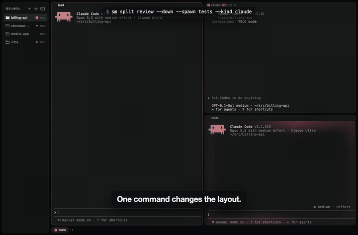

# sm

**Where your agents live.**

[](docs/demo.mp4)

<p align="center"><a href="docs/demo.mp4"><strong>Watch the full demo (MP4)</strong></a></p>

sm is the Mac front of [seol](https://github.com/oesoll/seol): it draws your coding agents as workspaces, tabs and panes, and changes that layout with one command per change, from you or from an agent. The agents themselves are seol's sessions, so quitting sm, closing a pane or rebooting does not end them.

The app is called SpaceManager; its command is `sm`. **Install it through seol** — sm needs seol's session layer to have anything to show:

```
Set up seol for me: read https://raw.githubusercontent.com/oesoll/seol/main/SETUP.md and follow it.
```

## Why it is designed this way

### Sessions belong to seol, not to the app

sm never owns an agent. Each one is a seol session held by its own `peer-hold` process on the machine it runs on; a pane only attaches to it (`sm-session attach NAME@HOST`). Layout is data too: a workspace's tabs and split tree live in `~/.smux/state/sm/workspaces/<ws>.json` on that machine, and the app draws the file. So an agent can rearrange your screen with the same commands you use, and nothing is lost when the app goes away.

This boundary came from real session-loss incidents when tmux and the app were tangled together, and the app no longer runs tmux at all: a workspace without a layout gets one from the session layer (`sm ws new`, one tab with a shell pane) the first time you open it.

### Native windows, libghostty terminals

Windows, sidebars, state, and navigation use SwiftUI and AppKit. Each terminal is a [libghostty](https://github.com/ghostty-org/ghostty) surface: it owns its PTY and child process and draws with Metal inside the app process. Keyboard and Korean IME handling follow Ghostty's own macOS view (`interpretKeyEvents` and `NSTextInputClient`, reusing the original key event when modifiers are unchanged).

Terminals used to be a `WKWebView` running xterm.js. Every web view started its own WebKit content process, so four panes meant four more processes of tens of MB each (measured 10/31). With libghostty the first terminal adds about 18 MB to the app for Metal and font setup and each further terminal about 3 MB, with no helper processes. The palette and minimum contrast are the same values xterm used, and so is the font: Menlo, with Korean from the system fallback (Apple SD Gothic Neo). terminal.html listed D2Coding first, but WebKit does not expose user-installed fonts to web content, so xterm always drew Menlo and the system Korean font; carrying the list over literally brought D2Coding back, which had already been rejected as tiring to read. The Korean font is deliberately not named in the config: Ghostty treats a configured family as primary and skips its fallback size adjustment, so Hangul drew small inside its two cells and syllables spread apart like words. Left to the fallback, Ghostty scales it to Menlo's height, as native Ghostty does. sm writes its own Ghostty config and does not read the user's Ghostty settings.

The terminal layer lives in a sibling package, `../GhosttyTerminal`, which Fine uses too, so a fix to input, rendering or the engine lands in both apps at once. It applies three small patches to libghostty (`../GhosttyTerminal/scripts/ghostty-patches/`): `login(1)` runs quietly so no pane prints "Last login"; a pane without focus draws no cursor, not even Ghostty's hollow box, so only the pane that takes keys shows one; and two-cell glyphs (Korean from the system fallback font, which is narrower than two cells) are centred in their cells, in text and in the composing preedit, so the spacing is even and the preedit underline sits under the glyph.

Workspace windows place a sidebar card and a terminal card on a flat canvas, separated by hairlines rather than shadows. Each sidebar row shows a folder icon (its color can be set per workspace from the context menu), the name, the activity dot, and where it runs (`mac`, `arch`, …). The sidebar button switches between the full sidebar and a compact rail of colored folder icons at the same vertical positions. Light and dark apply to the whole window, terminal palette included.

The sidebar and terminal card move together with a fixed gap. The terminal viewport stays at its existing size during the transition and receives the final size once the animation ends, avoiding repeated redraws. Tab switches retain the outgoing surface until the selected terminal has rendered, then fade between them.

Layout tabs (workspaces drawn from session-layer data) that have been shown once stay mounted, stacked, and only the selected one is visible. Rebuilding a tab's panes on every switch stalled the main thread for 40–70 ms and showed empty cards for a frame before the reattached terminals drew (measured with `sm perf` and `sm capture --burst`). Hidden tabs' surfaces are occluded, so they do not render, take keys, hover focus, clicks, or the focus rim; the shown tab's focused pane takes the keyboard. Switching workspaces clears the stack.

### Activity comes from transcripts

The activity dots do not poll agent processes and do not infer activity from terminal repainting. SpaceManager watches Claude, Codex, and Gemini transcripts with FSEvents. Only changed, known transcripts are statted for the generating indicator; a one-shot timer expires that indicator without reopening files. A 30-second reconciliation discovers missed changes and ages out old activity, reusing parsed metadata for unchanged files. Transcript timestamps determine recency, so a batch mtime touch does not make old conversations appear new.

Display scanners pause when every window is covered or minimized, reconcile when a window becomes visible, and stop when their last consumer closes.

### Model catalogs come from installed CLIs

The new-agent picker lists Claude model IDs extracted from the installed Claude executable, and Codex models and reasoning levels from `~/.codex/models_cache.json`. These CLI-owned catalogs are the source of truth, with a small fallback list used only when discovery fails.

### Glass only where something floats

The canvas, sidebar and pane cards are opaque. Earlier builds applied behind-window blur to large surfaces, and measurement with several large windows showed high WindowServer CPU use. Translucent material is kept for the small things that float over a terminal: a pane's name capsule and the list of agents in other tabs.

### Terminal colours are assigned by role

The 16 ANSI slots are painted by role rather than by name, the same palette as Fine. Claude's `*-ansi` themes emit 97 for emphasis, 37 for secondary text, 94 for inline code and links and 91 for its accent, so 37 is a grey and the light palette keeps 97 near-black. A 4.5:1 minimum contrast keeps truecolor output (Codex syntax highlighting) legible on either background. New tabs drop an inherited `NO_COLOR`. `TerminalColorCaptureTests` and `WindowCaptureTests` (`SM_CAPTURE=1`, isolated home and `TMUX_TMPDIR`) render real captures for review.

### Panes and agent states are drawn by the app

Terminals run to the bottom of the window. Tabs do not take a row of their own: their chips sit in a notch cut into the bottom-left of the terminal cards, as wide as the chips and no wider, with inner corners rounded and a small flare where the notch meets the card edge. The bottom line a Claude or Codex screen loses to the notch is its status line. Chips follow herdr's tab bar: `+` at the end, drag to reorder, double-click to rename, ⌘1–9 and ⌥⌘←→ to switch. The active chip is a pale pink and moves with a fade; each chip carries the most urgent agent state inside it. The sidebar lists workspaces only.

A matching notch at the bottom right shows the sessions of this workspace that are in a tab you are not looking at (and the panes a zoomed pane hides): harness logos overlap, three at most, then `+N`. Hovering opens the list upward from the notch, with each session's tab; clicking a running one opens a live preview of it above the notch, with a button to go to its tab. A sleeping one is not previewed, because attaching wakes it; clicking it goes to its tab. The list is computed from the layout and peer state, so it costs no polling.

A tab can be split into panes (⌘D right, ⇧⌘D down, ⌘[ / ⌘] to move, ⇧⌘↩ to zoom one). Following herdr's `pane_gaps`, panes do not share divider lines: each becomes its own card on the canvas, with the same gap and corner radius as the sidebar card, and the gap between two cards is the resize handle. The focused card's rim is the accent colour; it keeps its rounded rectangle and slips under a notch rather than bending around it. A pane's name floats in a small capsule at its top-right corner instead of taking a header row. Grab the capsule or the card's top edge and drag: the card follows the pointer, the pane under it lights up, and dropping there swaps the two (`sm swap`); dropping elsewhere springs it back. An unsplit tab has no capsule and is drawn as a plain card. Notch widths, swaps and workspace switches share one critically damped spring; with Reduce Motion they cross-fade.

Agent state comes from `peer --all --json`, read every two seconds while a window is visible. A pane is matched to its agent through the `SM_PANE_ID` its shell receives (peer reports it as `sm:<UUID>`). States are told apart by shape as well as colour: a pink exclamation circle waits on you (permission or question), an amber triangle failed, the existing spinner is working, and a plain dot means it finished after you last looked at that pane. Idle panes show nothing. Workspace and tab rows show the most urgent state inside them, and ⌘J jumps to the next pane waiting on you. "Finished but unseen" is remembered by the app, not by peer, and starts empty on launch.

Where the session layer keeps a workspace's layout (`~/.smux/state/sm/workspaces/<ws>.json` on the machine the workspace runs on), the window draws that file: its tabs in the bottom-left notch, its split tree of panes, each pane attached to the session it names. The file is the source; the app reads it (FSEvents locally, one `sm-session watch` per visible remote workspace) and changes it only through `sm-session` commands, the same ones an agent uses (`sm split`, `resize`, `focus`, `zoom`, `close`, `tab select`). Clicks and drags show at once and the command follows; a dragged boundary is previewed on screen and written once on release with `--toward`, so only its two neighbours change. A pane whose agent is still in tmux is labelled `tmux` and can be moved into seol (`sm-session migrate`) while the agent is idle.

How a pane attaches to its terminal lives in one file, `TerminalAttachment`: a login shell, or `sm-session attach NAME@HOST` for an agent session. The session layer (`sm-session`, a CLI on every machine) starts, keeps, attaches to and revives agent sessions, the work tmux used to do; it picks the local holder or `ssh -t` to the other machine. The `sm` CLI passes `spawn`, `attach`, `resume`, `ls`, `tail`, `stop` and `restore` straight to it, so `sm spawn …` is the same command on every machine.

## How to use

### Requirements

- macOS 14 or later on Apple Silicon
- [seol](https://github.com/oesoll/seol), which installs this app, the `sm` CLI and the session layer together
- Claude Code and/or Codex

### Build from source

```sh
git clone https://github.com/oesoll/SpaceManager.git
cd SpaceManager
./scripts/test-isolated.sh            # tests with a temporary home
scripts/package-app.sh release        # .build/SpaceManager.app and .build/release/sm
```

seol's installer runs the same script and copies the app to `/Applications` and `sm` to `~/.local/bin`. To work on the terminal engine, check out [GhosttyTerminal](https://github.com/oesoll/GhosttyTerminal) next to this repository; `Package.swift` uses that sibling when it exists (its `scripts/build-ghostty.sh` needs Zig 0.17).

### Basic workflow

```sh
sm ws new billing-api --cwd ~/src/billing-api            # a workspace in the sidebar
sm split main.0 --right --spawn lead --kind claude        # an agent in a new pane
sm split lead --right --spawn review --kind codex
sm tab new --name workers --spawn w1 --kind claude
sm arrange workers grid                                   # columns, rows, grid, main-left, main-top
sm show review                                            # bring a pane in front of you
```

Layout commands never move your view or keyboard; only `--focus`, `sm focus`, `sm tab select` and `sm show` do. Every change prints the new shape, `*` marking what you see:

```
billing-api@mac  main*: [lead* | review] · workers: [(w1 | w2) / (w3 | w4)]
```

| Shortcut | Action |
|---|---|
| `Command-N` | Open a workspace window |
| `Command-Shift-N` | Add a workspace |
| `Command-T` | Open a tab and pick the agent for it |
| `Command-D` / `Command-Shift-D` | Split the pane right / down |
| `Command-J` | Jump to the next pane waiting on you |
| `Command-Option-Left/Right` | Select the previous or next tab |

## Remote workspaces

A workspace can run on another machine. Its layout and its agents' sessions then live on that machine; the sidebar row only says where. Set an ssh host
alias by clicking the small **computer / server icon** beside a workspace name.
The icon appears only while its row is selected or hovered. Choose **이 Mac**
for native macOS work, **아치 · arch** for the Arch computer, or **다른 SSH 호스트…**
for another configured SSH alias. The same choices are in the context menu under
**실행 위치**. The CLI remains `sm app ws remote <ws> <host>`; `none` selects this Mac.

Each workspace keeps its own destination, so local Xcode projects and remote agents
can share the same app window. Changing the destination does not copy project files;
the window then draws the layout of the same name on the new machine.
A missing Mac checkout blocks switching to local.
Activity dots follow both the project path and its host.

The **+ / New Workspace** sheet also offers **이 Mac / 아치 / 다른 호스트**.
Remote folders can be entered as `~/src/project` without creating a local copy.

- An agent pane runs `sm-session attach NAME@HOST`; the session layer reaches the
  other machine. A shell pane of a remote workspace runs `ssh -t <host>` into the
  workspace folder there.
- Paths under the local home are translated to the remote `$HOME`
  (`/Users/me/src/x` → `$HOME/src/x`), so the same folder layout on
  both machines needs no per-workspace configuration. Paths outside the home
  are sent unchanged.

The ssh alias comes from `~/.ssh/config`; a `ProxyCommand` that picks the
route (VPN or LAN) works transparently, and `ControlMaster` keeps reconnects
cheap.

An agent pane whose attach ends from outside (the Mac slept, ssh dropped) attaches
again after 3 seconds, backing off to 30. While it does, the pane keeps the last
frame it received and drops keystrokes, so nothing typed at the frozen screen
reaches the agent after the reconnect. Attaching again never starts a stopped
session by itself.

### Remote activity

Activity dots read local transcripts, so a remote workspace
would otherwise stay dark. `scripts/remote-activity-mirror.sh <host>` closes
that gap without copying transcripts: every five seconds it runs
`scripts/remote-activity-summary.py` on the host over ssh (sent on stdin, so
nothing is installed there) and stores the result, a few kilobytes of
per-transcript cwd, last-event time, and last user message, in
`~/.space-manager/remote/<host>/activity.json`. The app watches that folder,
maps remote-home paths back to the local home, and tags the sessions with the
host. The generating indicator uses the remote mtimes with clock skew
corrected from the summary's own timestamp, and stops after 30 seconds without
a fresh summary. Install it as a launchd agent with
`scripts/install-remote-mirror.sh <host>` (`--uninstall` removes it). The
mirror only pulls; the remote machine never needs to reach the Mac.

## sm CLI

Everything the app can do is also available from the terminal. The app opens a
line-delimited JSON control socket at `~/.space-manager/control.sock`, and
`sm` (`swift build -c release` → `.build/release/sm`, installed as `~/bin/sm`)
sends one request per connection. When the app is not running, `sm` launches
it and waits for the socket.

```text
sm windows                          창 목록
sm window new                       새 창
sm window focus|close <win>         창 앞으로/닫기
sm window appearance <win> <light|dark|system>

sm app ws [list]                    사이드바 워크스페이스 목록 (모든 창)
sm app ws add <path> [--name N]     워크스페이스 추가
sm app ws select|delete <ws>        선택(창 앞으로)/사이드바에서 빼기(배치와 세션은 남는다)
sm app ws rename <ws> <name>        이름 변경 (빈 문자열이면 폴더명)
sm app ws layout-name <ws> <name>   이미 있는 배치(sm ws ls)에 이 항목을 잇는다
sm app ws remote <ws> <host|none>   실행 위치 (ssh 별칭)
sm app ws move <ws> <index>         순서 이동
sm project add|remove <ws> <path>   추가 프로젝트 폴더

sm reveal NAME[@HOST]               그 에이전트가 보이는 패널을 앞으로(워크스페이스·탭·패널, 키 입력까지).
                                    어느 패널에도 없으면 새 탭에 붙인다. Fine 노치 알림을 누르면 Fine이 부른다

sm capture [-w win] <file.png> [--rect x,y,w,h]   창을 찍는다(앱이 자기 창을 찍어 화면 기록 권한이 필요 없다)
sm capture [-w win] --rect x,y,w,h --burst N [--every MS] [dir]
                                    같은 자리를 N번 연달아 찍어 시각(ms)과 평균 색을 낸다
sm perf keys NAME [-n COUNT]        보이는 탭의 NAME 패널에 키를 넣고 화면에 그려지기까지(키 → 화면).
                                    NAME은 sm-bench-로 시작해야 한다(실제 에이전트에 글자가 들어가지 않게)
sm perf [-w win] [seconds] [--do tab:N|tab:next|focus:next|ws:NAME] [--rect x,y,w,h]
                                    메인 스레드가 놓친 프레임. --do는 0.3초 뒤 사람이 누르는 길로 한 번
                                    움직이고, --rect는 같은 시간축에서 그 자리가 언제 바뀌고 멈췄는지 낸다

sm activity                         에이전트 활동 (transcript 기반)
sm state                            window-states.json 덤프
sm ping
```

`sm capture` and `sm perf` exist so an agent can check what a person reports on
screen ("the fade stutters", "tab switches lag") without screen-recording
permission. `--do` changes the window's state (its tab, focus, or workspace),
so point it at a window nobody is using. The same measurement runs in isolation
with `SM_CAPTURE=1 SM_CAPTURE_SCENE=tabswitch scripts/test-isolated.sh --filter
PaneCaptureTests` (results in `.build/window-capture/tabswitch.json`).

Options: `--json` prints the raw response, `-w/--window <id|index|front>`
picks the window, `--no-focus` leaves the app in the background. `<ws>` is a
name, layout name, path, or id prefix; `<win>` is an index, id prefix, or `front`.
Tabs and panes are the session layer's (`sm tab …`, `sm split …`), the same on every machine.

The protocol is `{"command":"ws.select","args":{"ws":"flat"}}\n` →
`{"ok":true,"result":{…}}\n` or `{"ok":false,"error":"…"}\n`. The app-side
router lives in `Sources/SpaceManager/Control/`; a new UI feature gets its
command in the same commit.

## Credits

- Terminal rendering and input use [libghostty](https://github.com/ghostty-org/ghostty) (MIT). The surface view and its IME handling are adapted from Ghostty's macOS app.
- Early versions ran agents in tmux and passed messages with the [smux](https://github.com/ShawnPana/smux) skill by [ShawnPana](https://github.com/ShawnPana); SpaceManager itself was first built that way. Agents adopted from [tmux](https://github.com/tmux/tmux) keep running there until the session layer migrates them.

SpaceManager is released under the [MIT License](LICENSE).
